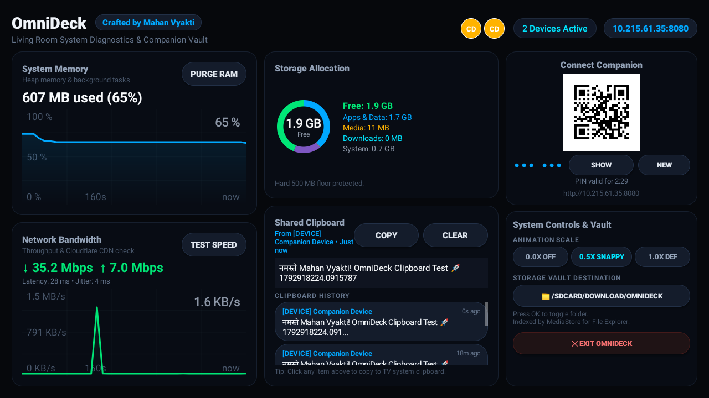
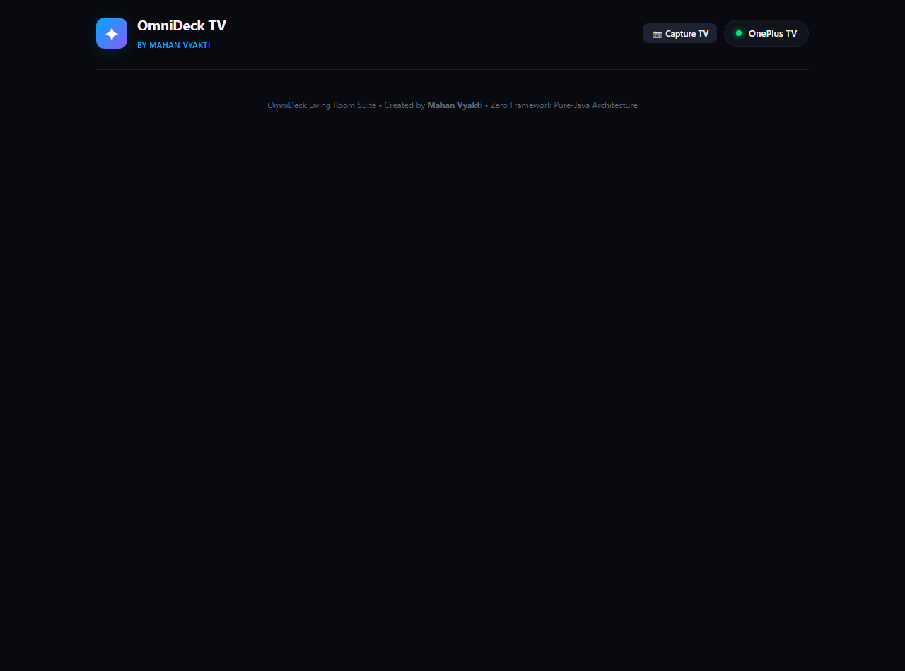
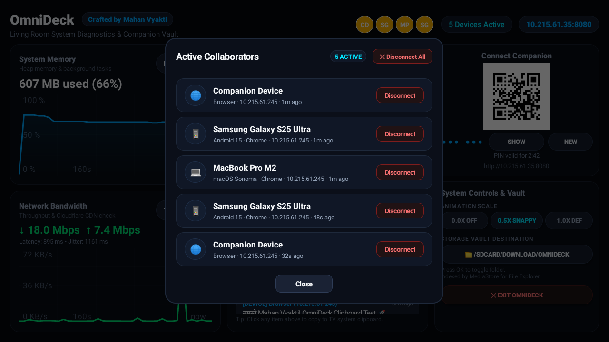

# OmniDeck 📺⚡

> Ultra-lightweight system diagnostics, remote file vault, and browser companion hub built for Android TV.

OmniDeck is an independent Android application (`com.mahanapps.omnideck`) designed specifically for Android TV (Leanback). It consumes less than 20 MB of PSS RAM and hosts an embedded zero-dependency local web companion, allowing you to manage your TV, sync clipboards, transfer files, and monitor hardware health from any phone, tablet, or PC browser without installing client apps.

---

## Screenshots

| Leanback TV Dashboard | Connected Browser Companion |
|---|---|
|  |  |

| Active Devices & Telemetry Modal |
|---|
|  |

---

## Key Features

- **Leanback Diagnostics Dashboard**: Live RAM gauge, granular storage utilization (Apps & Data, Media, Downloads, OS partitions), and network throughput history with clean axis units.
- **Physical-Presence PIN Pairing**: Rolling 6-digit PIN on the TV screen authenticates client browsers and issues secure 128-bit Bearer tokens.
- **Client Metadata Recognition**: Extracts accurate device model names (e.g. `Samsung Galaxy S25 Ultra`, `macOS Sonoma · Chrome`) instead of frozen mobile user agents.
- **Safe Wireless File Vault**: Drag-and-drop file transfers directly to `/sdcard/Download/OmniDeck` protected by an enforced 500 MB storage floor reserve and path-traversal jails.
- **Instant Clipboard & NoteBoard**: Bi-directional text and URL sync between phones/PCs and the TV's native clipboard with full Unicode/Hindi rendering.
- **Remote TV Actions**: One-click RAM cache purging, live network speed testing, cross-app TV screen capture, and remote keyboard typing into TV text boxes.
- **Dual-Device Verified**: Tested and verified on **OnePlus 32 Y1S** (Android 11) and **Xiaomi Mi TV 4X 50** (Android 9).

---

## Prerequisites

1. **Java Development Kit**: JDK 17 (required by Android Gradle Plugin 8.5+).
   - **macOS**: `brew install openjdk@17`
   - **Ubuntu / Debian**: `sudo apt update && sudo apt install -y openjdk-17-jdk`
   - **Windows**: `winget install Microsoft.OpenJDK.17` or `choco install openjdk17`
2. **Android SDK**: Build tools 34.0.0, Platform API 34.
3. **Make & Python 3** (Optional, for developer automation recipes and test bridges):
   - **macOS**: `brew install make python`
   - **Ubuntu / Debian**: `sudo apt install -y build-essential python3 python3-pip`
   - **Windows**: Python 3.10+ and Make (via Chocolatey `choco install make` or Git Bash / MSYS2).

---

## Local Setup & Build

### 1. Clone & Configure
```bash
# Clone the repository
git clone <your-repo-url> OmniDeck
cd OmniDeck

# Configure your Android SDK path in local.properties:
# macOS default:
echo "sdk.dir=$HOME/Library/Android/sdk" > local.properties

# Linux default:
echo "sdk.dir=$HOME/Android/Sdk" > local.properties

# Windows (PowerShell):
echo "sdk.dir=C:\\Users\\$env:USERNAME\\AppData\\Local\\Android\\Sdk" > local.properties
```

### 2. Build via Make (Cross-Platform)
OmniDeck includes a smart Makefile that automatically detects your operating system and routes commands through `tools/run_gradle.bat` (Windows) or `tools/run_gradle.sh` (Linux / macOS), automatically discovering Java 17 installations:
```bash
# Build debug APK
make build

# Run JVM unit test suite
make test

# View all available recipes
make help
```

### 3. Build via Gradle Directly
```bash
# Linux / macOS
./gradlew assembleDebug

# Windows (Command Prompt / PowerShell)
.\gradlew.bat assembleDebug
```
The compiled APK will be generated at:
`app/build/outputs/apk/debug/app-debug.apk`

---

## TV Installation & Pairing

### Method A: Over Standard ADB
```bash
# 1. Connect to your TV over Wi-Fi
adb connect <TV_IP>:5555

# 2. Install debug build
adb -s <TV_IP>:5555 install -r app/build/outputs/apk/debug/app-debug.apk

# 3. Grant permissions & launch
adb -s <TV_IP>:5555 shell appops set com.mahanapps.omnideck GET_USAGE_STATS allow
adb -s <TV_IP>:5555 shell am start -n com.mahanapps.omnideck/.android.OmniDeckActivity
```

### Method B: Via Makefile Automation
```bash
# Rebuild, push, grant permissions, and start OmniDeck on your TV in one command:
make restart TV_HOST=<TV_IP>
```

### Pairing with Companion Device
1. Open OmniDeck on your TV and note the 6-digit PIN and IP shown on screen.
2. Open any browser on your phone or PC on the same Wi-Fi network and navigate to:
   ```
   http://<TV_IP>:8080
   ```
3. Enter the 6-digit PIN to establish an authenticated session.

---

## Potential Pitfalls & Troubleshooting

### 1. `Android Gradle plugin requires Java 17 to run. You are currently using Java 11.`
- **Cause**: Your system default `JAVA_HOME` points to Java 11 or older.
- **Fix**: Point `JAVA_HOME` to JDK 17 before running Gradle, or use `make build` (which automatically checks for local JDK 17 installations).

### 2. File Upload Returns `HTTP 507 Insufficient Storage`
- **Cause**: OmniDeck enforces a strict safety floor to prevent TV flash memory from filling up completely (which can brick Android TV).
- **Fix**: The default floor requires at least 500 MB (or 10% of total storage). On devices with less than 500 MB free, OmniDeck dynamically scales down the reserve floor, but if the device has less than 100 MB remaining, uploads are rejected until disk space is cleaned.

### 3. RAM Purge Reports "0 Background Processes Killed"
- **Cause**: This is normal Android OS behavior. OmniDeck uses `ActivityManager.killBackgroundProcesses()`. When returning from memory-intensive apps (e.g., YouTube), the Linux kernel's Low Memory Killer (LMK) daemon already terminated cached processes to free memory.
- **Fix**: No action needed; the system memory gauge accurately reflects currently active RAM.

### 4. Cross-App Screenshot Capture Returns `500 Failed`
- **Cause**: Android accessibility service is disabled or ungranted.
- **Fix**: On TV, navigate to **Settings → Device Preferences → Accessibility → OmniDeck Accessibility Service** and turn it **ON**. Or run:
  ```bash
  adb shell settings put secure enabled_accessibility_services com.mahanapps.omnideck/.android.OmniDeckAccessibilityService
  adb shell settings put secure accessibility_enabled 1
  ```

### 5. Companion Shows Device Name as Single Letter "K"
- **Cause**: Modern mobile browsers (e.g. Chrome on Android) intentionally freeze the standard `User-Agent` string to `(Linux; Android 10; K)`.
- **Fix**: OmniDeck automatically requests modern Client Hints (`navigator.userAgentData.getHighEntropyValues(['model'])`) and resolves hardware model names (e.g. `SM-S938` → Samsung Galaxy S25 Ultra). Ensure the companion page is served over HTTP/HTTPS without ad-blockers stripping Client Hints headers.

### 6. TV Wi-Fi Disconnects During Inactivity
- **Cause**: Android TV enters deep sleep / Daydream screensaver, suspending network sockets.
- **Fix**: Send a wake event via remote or ADB:
  ```bash
  make start TV_HOST=<TV_IP>
  ```

---

## Technical Documentation

For an in-depth review of internal architecture, security protocols, and Android compatibility decisions, see [docs/DESIGN.md](docs/DESIGN.md).

---

## License

MIT License. Designed and crafted for smooth, bloat-free Android TV pair programming and device management.
